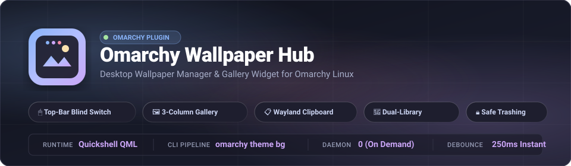
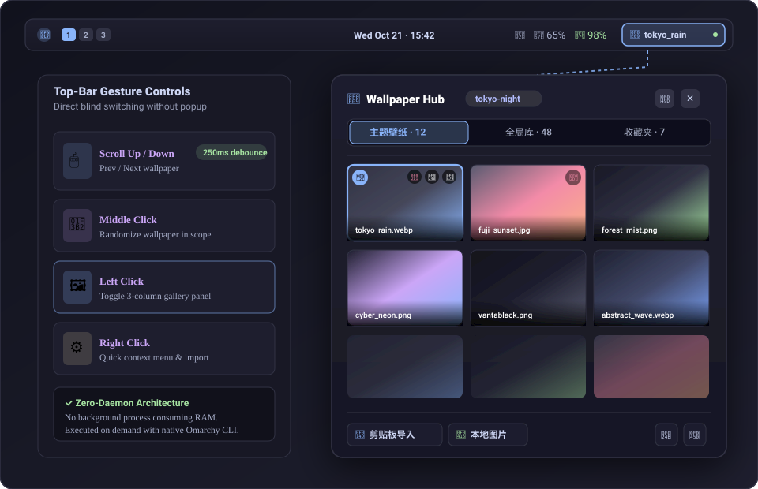
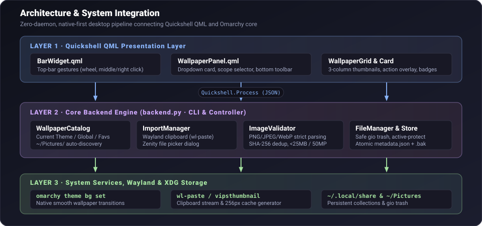
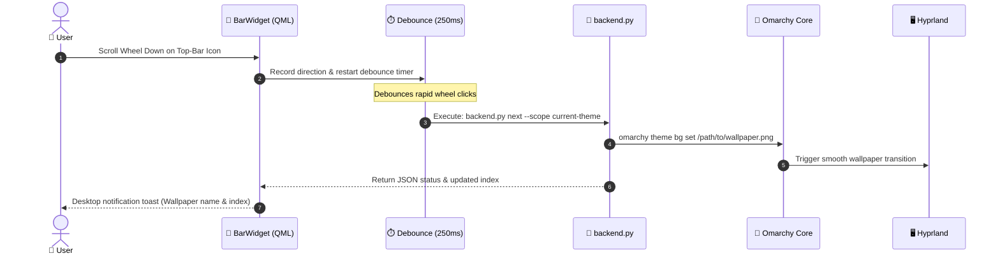

<p align="center">
  
</p>

<p align="center">
  <a href="https://plugins.omarchy.org"></a>
  <a href="LICENSE"></a>
  
  
  
  <a href="README_zh.md"></a>
</p>

<p align="center">
  <b>English</b> | <a href="README_zh.md"><b>简体中文</b></a>
</p>

---

## 💡 Overview

**Omarchy Wallpaper Hub** is an ultra-fast, native desktop wallpaper manager and gallery widget engineered specifically for **Omarchy Linux** (Quickshell + Hyprland).

Designed with a **Native-First, Zero-Daemon** philosophy, it hooks directly into the official Omarchy CLI wallpaper pipeline (`omarchy theme bg set`) without background daemon bloat. It provides instant blind switching via mouse gestures on the top bar, a responsive 3-column thumbnail gallery, seamless Wayland clipboard wallpaper import, and automatic zero-copy discovery of existing user pictures.

---

## 🖼️ UI & Desktop Interaction Showcase

<p align="center">
  
</p>

---

## 🕹️ Top-Bar Gestures & Interaction Guide

| Trigger | Target | Action & Behavior |
| :--- | :--- | :--- |
| 🖱️ **Scroll Down** | Top-bar icon | Cycle to **Next** wallpaper in active scope (*250ms debounced*) |
| 🖱️ **Scroll Up** | Top-bar icon | Cycle to **Previous** wallpaper in active scope (*250ms debounced*) |
| 🎲 **Middle Click** | Top-bar icon | Apply a **Random** wallpaper from the active scope |
| 🖼️ **Left Click** | Top-bar icon | **Toggle** 3-column gallery popup card |
| ⚙️ **Right Click** | Top-bar icon | Open **Quick Context Menu** (Clipboard import, local file, folder, refresh) |
| 💬 **Hover** | Top-bar icon | View tooltip with current wallpaper name, active scope, and total count |
| 👆 **Left Click** | Gallery card | **Apply** selected wallpaper immediately (shows checkmark badge 󰄬) |
| 󰋑 **Heart Icon** | Card top-right | **Favorite / Unfavorite** wallpaper (syncs to `Favorites` scope) |
| 󰉋 **Folder Icon** | Card top-right | **Reveal** wallpaper file in default file manager (*xdg-open*) |
| 󰩹 **Trash Icon** | Card top-right | Safely move wallpaper to system trash (*active wallpaper is protected*) |
| <kbd>Esc</kbd> / Click Away | Anywhere | Close gallery panel |

---

## 🌟 Key Features

### 1. ⚡ Native-First Architecture
- Delegates wallpaper setting to the official Omarchy command `omarchy theme bg set <path>`.
- Preserves smooth Hyprland wallpaper transitions and native system symlink configurations.
- **Zero background daemon**: runs strictly on-demand without persistent memory overhead.

### 2. 🎨 Dual-Library & Zero-Migration Discovery
- **Current Theme Library**: Dynamically tracks Omarchy's active theme (e.g. `vantablack`, `catppuccin`, `tokyo-night`), scanning both system preset backgrounds and user-customized theme backgrounds (`~/.config/omarchy/backgrounds/<theme>/`).
- **Global Wallpaper Library**: A universal collection that persists across Omarchy theme switches (`~/.local/share/omarchy-wallpaper-hub/wallpapers/`).
- **Zero-Migration Pictures Discovery**: Automatically indexes wallpapers located in `~/Pictures/wallpapers/` directly into the catalog without requiring manual copying or file duplication.
- **Favorites Scope**: Mark your best wallpapers with one click for rapid cycling.

### 3. 📋 Instant Wayland Clipboard Import
- Copy any image directly from your web browser or screenshot tool (`wl-copy`).
- Click **"Clipboard Import"** or press <kbd>Super</kbd> + <kbd>Alt</kbd> + <kbd>V</kbd> to validate, hash, deduplicate, save to the global library, and set as active wallpaper in milliseconds.
- Built-in Zenity graphical file chooser for selecting local image files.

### 4. 🔒 Enterprise-Grade File Safety
- **Strict Validation**: Decodes static PNG, JPEG, and WebP headers; rejects corrupted images and animated formats (GIFs).
- **Resource Protection**: Enforces a 25 MB file size limit and a 50 Megapixel resolution limit to prevent memory exhaustion.
- **SHA-256 Deduplication**: Prevents duplicate imports of identical images.
- **Safe Trashing**: File deletions use FreeDesktop `gio trash` rather than permanent removal (`rm`). Native theme presets and the currently active desktop wallpaper are strictly write-protected.

---

## 🏗️ Architecture & Workflow

<p align="center">
  
</p>

### Instant Blind Switching Workflow



---

## 📂 Storage & Data Paths (XDG Compliant)

| Purpose | Directory / File Path | Description |
| :--- | :--- | :--- |
| **Global Wallpapers** | `~/.local/share/omarchy-wallpaper-hub/wallpapers/` | Managed global static wallpaper collection |
| **Existing Pictures** | `~/Pictures/wallpapers/` | User pictures automatically discovered and indexed |
| **Metadata & Favorites** | `~/.local/share/omarchy-wallpaper-hub/metadata.json` | JSON store tracking favorites, import times, and hashes (with `.bak` safety) |
| **Thumbnail Cache** | `~/.cache/omarchy-wallpaper-hub/thumbnails/` | Fast 256px previews generated via `vipsthumbnail` |
| **Active Theme Presets** | `~/.local/state/omarchy/current/theme/backgrounds/` | Read-only backgrounds bundled with the current Omarchy theme |
| **User Theme Wallpapers** | `~/.config/omarchy/backgrounds/<theme_name>/` | User wallpapers customized for specific Omarchy themes |

> 🛡️ **Uninstall Safety**: Uninstalling or disabling the widget will **never** delete your wallpaper images or your favorites metadata.

---

## 💻 CLI Command Reference (`backend.py`)

All core functionality is accessible via `backend.py`, outputting structured JSON for scripting, keybinding integration, or debugging:

```bash
# Check current wallpaper status, theme, and library counts
python3 backend.py status

# List wallpapers by scope (current-theme / global / favorites)
python3 backend.py list --scope current-theme
python3 backend.py list --scope global
python3 backend.py list --scope favorites

# Switch wallpapers within a specific scope
python3 backend.py next --scope current-theme
python3 backend.py previous --scope global
python3 backend.py random --scope favorites

# Apply a specific wallpaper by path or ID
python3 backend.py apply /home/user/Pictures/wallpapers/sunset.jpg

# Import from Wayland clipboard and apply immediately
python3 backend.py import-clipboard --target global

# Import from a local file
python3 backend.py import-file ~/Downloads/new_wallpaper.png --target global

# Toggle favorite state
python3 backend.py favorite "global:new_wallpaper.png" --toggle

# Safely trash a wallpaper (inactive global wallpapers only)
python3 backend.py delete "global:new_wallpaper.png"
```

---

## ⌨️ Recommended Hyprland Keybindings

Add the following shortcuts to enable full keyboard-driven wallpaper management:

### Option A: `~/.config/hypr/bindings.conf`
```ini
# Super + Alt + W: Cycle next wallpaper
bind = SUPER ALT, W, exec, python3 ~/.config/omarchy/plugins/io.github.chivopic.wallpaper-hub/backend.py next

# Super + Alt + Q: Cycle previous wallpaper
bind = SUPER ALT, Q, exec, python3 ~/.config/omarchy/plugins/io.github.chivopic.wallpaper-hub/backend.py previous

# Super + Alt + R: Randomize wallpaper
bind = SUPER ALT, R, exec, python3 ~/.config/omarchy/plugins/io.github.chivopic.wallpaper-hub/backend.py random

# Super + Alt + V: Apply clipboard image as wallpaper
bind = SUPER ALT, V, exec, python3 ~/.config/omarchy/plugins/io.github.chivopic.wallpaper-hub/backend.py import-clipboard
```

### Option B: `~/.config/hypr/bindings.lua` (Omarchy Lua Config)
```lua
-- Super + Alt + W: Cycle next wallpaper
hl.bind({"SUPER", "ALT"}, "W", "exec", "python3 ~/.config/omarchy/plugins/io.github.chivopic.wallpaper-hub/backend.py next")

-- Super + Alt + Q: Cycle previous wallpaper
hl.bind({"SUPER", "ALT"}, "Q", "exec", "python3 ~/.config/omarchy/plugins/io.github.chivopic.wallpaper-hub/backend.py previous")

-- Super + Alt + R: Randomize wallpaper
hl.bind({"SUPER", "ALT"}, "R", "exec", "python3 ~/.config/omarchy/plugins/io.github.chivopic.wallpaper-hub/backend.py random")

-- Super + Alt + V: Apply clipboard image as wallpaper
hl.bind({"SUPER", "ALT"}, "V", "exec", "python3 ~/.config/omarchy/plugins/io.github.chivopic.wallpaper-hub/backend.py import-clipboard")
```

---

## 🚀 Installation & Enabling

### Method 1: Using Omarchy CLI (Recommended)
```bash
omarchy plugin add https://github.com/chivopic/omarchy-wallpaper-hub.git --enable
```

### Method 2: Manual Installation
```bash
# 1. Clone repository into Omarchy plugins directory
mkdir -p ~/.config/omarchy/plugins
git clone https://github.com/chivopic/omarchy-wallpaper-hub.git ~/.config/omarchy/plugins/io.github.chivopic.wallpaper-hub

# 2. Enable widget on the right side of the top bar
omarchy plugin enable io.github.chivopic.wallpaper-hub right
```

---

## 🧪 Testing

The test suite validates image parsing, format verification, security boundaries, metadata persistence, and file deletion safety:

```bash
python3 -m unittest tests/test_backend.py
```

---

## 🛡️ License

Distributed under the [MIT License](LICENSE).  
Copyright © 2026 [chivopic](https://github.com/chivopic).
