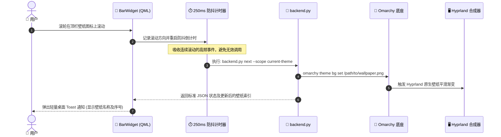

<p align="center">
  
</p>

<p align="center">
  <a href="https://plugins.omarchy.org"></a>
  <a href="LICENSE"></a>
  
  
  
  <a href="README.md"></a>
</p>

<p align="center">
  <a href="README.md"><b>English</b></a> | <b>简体中文</b>
</p>

---

## 💡 项目简介

**Omarchy Wallpaper Hub** 是专为 **Omarchy Linux**（Quickshell + Hyprland）量身打造的极速原生桌面壁纸管理微件与画廊插件。

项目坚持 **“Native-First 原生集成”** 与 **“Zero-Daemon 零常驻后台”** 的极简设计理念：底层直接复用 Omarchy 官方 CLI 管道（`omarchy theme bg set`），保持原生平滑壁纸渐变过渡动效，不引入多余的后台驻留进程与内存开销。提供顶栏鼠标手势盲切、三列缩略图画廊预览、Wayland 剪贴板图片一键设为壁纸、以及本地历史壁纸零迁移自动发现等多项实用能力。

---

## 🖼️ UI 界面与桌面交互总览

<p align="center">
  
</p>

---

## 🕹️ 顶栏手势与交互指南

| 交互手势 | 触发区域 | 对应行为与反馈 |
| :--- | :--- | :--- |
| 🖱️ **滚轮向下** | 顶栏微件图标 | 切换到当前范围的**下一张**壁纸（*250ms 防抖*） |
| 🖱️ **滚轮向上** | 顶栏微件图标 | 切换到当前范围的**上一张**壁纸（*250ms 防抖*） |
| 🎲 **鼠标中键** | 顶栏微件图标 | 在当前范围内**随机应用**一张壁纸 |
| 🖼️ **鼠标左键** | 顶栏微件图标 | **展开 / 收起** 三列缩略图壁纸画廊下拉面板 |
| ⚙️ **鼠标右键** | 顶栏微件图标 | 打开**快捷功能菜单**（剪贴板导入、添加本地图片、打开壁纸目录、刷新） |
| 💬 **鼠标悬停** | 顶栏微件图标 | 弹出 Tooltip 提示当前壁纸名称、当前分类范围及壁纸总数 |
| 👆 **单击卡片** | 画廊壁纸卡片 | **立即应用**选中的壁纸（显示当前激活高亮边框与勾选徽标 󰄬） |
| 󰋑 **心形图标** | 卡片右上角悬浮栏 | **收藏 / 取消收藏** 壁纸（实时同步至“收藏夹”分类） |
| 󰹤 **灰度图标** | 卡片右上角悬浮栏 | 一键将该彩色壁纸**转换为暗夜黑白壁纸**并立即生效应用 |
| 󰉋 **文件夹图标** | 卡片右上角悬浮栏 | 在默认文件管理器（*xdg-open*）中**定位**该壁纸文件 |
| 󰩹 **垃圾桶图标** | 卡片右上角悬浮栏 | 将壁纸安全移入系统回收站（*当前正在使用的壁纸受写保护禁止删除*） |
| 🖱️ **右键卡片** | 画廊壁纸卡片 | 快捷操作：在文件管理器中直接**定位该壁纸**（*免去瞄准小按钮*） |
| <kbd>Esc</kbd> / 外部点击 | 任意空白区域 | 关闭画廊下拉面板 |

---

## 🌟 核心特性

### 1. ⚡ Native-First 原生融合体系
- 壁纸设置完全接入 Omarchy 官方底座命令 `omarchy theme bg set <path>`。
- 完整保留 Hyprland 原生壁纸平滑淡入淡出过渡动效，不强行覆盖或破坏系统软链接体系。
- **零常驻后台进程**：纯按需调用 Python 脚本处理业务逻辑，日常运行零内存占用。

### 2. 🎨 双库协同与用户壁纸零迁移自动发现
- **当前主题库（Current Theme）**：动态绑定 Omarchy 当前激活主题（如 `vantablack`、`catppuccin`、`tokyo-night` 等），自动聚合主题内置预设壁纸与用户主题专用壁纸（`~/.config/omarchy/backgrounds/<theme>/`）。
- **全局壁纸库（Global Library）**：跨主题通用的独立壁纸库，切换系统主题时永久保留（`~/.local/share/omarchy-wallpaper-hub/wallpapers/`）。
- **本地图片零迁移自动索引**：自动扫描并无缝纳管 `~/Pictures/wallpapers/` 目录中的本地图片，无需手动拷贝复制。
- **收藏夹（Favorites）**：画廊中一键标星，支持限定在收藏范围内快速轮巡。

### 3. 📋 Wayland 剪贴板一键极速设壁纸
- 在浏览器中浏览图片或使用截图工具截屏时直接“复制图片”（`wl-copy`）。
- 点击微件面板底部的 **“剪贴板导入”** 按钮或按下快捷键 <kbd>Super</kbd> + <kbd>Alt</kbd> + <kbd>V</kbd>，微件将在毫秒级时间内自动完成合法性校验、去重计算、存入全局库并立即切换生效。
- 内置 Zenity 图形文件选择器，点击 **“本地图片”** 即可视化拾取本地单张或批量图片。

### 4. 🔒 工业级安全与文件防误删保障
- **严格格式校验**：原生解析 PNG、JPEG、WebP 图片头部结构，拦截破损损坏图片，拒收 GIF 动图。
- **资源防爆限制**：设定 25 MB 最大单文件限制与 5000 万像素（50 MP）最大分辨率限制，杜绝显存或内存崩溃。
- **SHA-256 内容去重**：重复导入相同图片自动识别并直接复用现有文件，防止磁盘碎片冗余。
- **安全回收机制**：删除操作接入 FreeDesktop 规范的系统回收站（`gio trash`），杜绝直接执行不可逆的 `rm`。系统主题预设壁纸与当前正在使用的活动壁纸均受系统级写保护。

### 5. 🌙 暗夜黑白与灰度滤镜调节引擎
- **多档饱和度调节**：纯黑白 0%、微冷淡 30%、低饱和 60%、原彩色 100%，随心切换。
- **暗夜护眼调光**：支持深度暗夜 70%、柔和 85%、正常 100% 亮度微调，避免浅色或过亮背景夜间刺眼。
- **全链路黑白支持**：
  - **卡片一键转换**：卡片右上角悬停点击 `󰹤` 即可瞬间生成黑白版本；
  - **面板顶部滤镜调节器**：点击标题栏 `󰹤` 展开灰度调光控制台，支持实时预览与应用；
  - **底栏「暗夜黑白模式」开关**：开启后，所有从剪贴板或本地导入的彩色图片将自动生成高质感黑白灰度壁纸。

---

## 🏗️ 系统架构与数据流转

<p align="center">
  
</p>

### 顶栏极速盲切时序流



---

## 📂 壁纸库与数据路径（遵循 XDG 规范）

| 数据分类 | 存储路径 | 作用与功能说明 |
| :--- | :--- | :--- |
| **插件全局壁纸** | `~/.local/share/omarchy-wallpaper-hub/wallpapers/` | 插件纳管的全局静态壁纸存放目录 |
| **用户现有壁纸** | `~/Pictures/wallpapers/` | 用户磁盘上现有的壁纸目录（自动无感索引） |
| **元数据与收藏** | `~/.local/share/omarchy-wallpaper-hub/metadata.json` | 存储收藏状态、哈希去重表及导入来源（带 `.bak` 容灾备份） |
| **缩略图缓存** | `~/.cache/omarchy-wallpaper-hub/thumbnails/` | 由 `vipsthumbnail` 异步生成的 256px 高性能预览缓存 |
| **主题预设壁纸** | `~/.local/state/omarchy/current/theme/backgrounds/` | Omarchy 当前主题预装的只读背景壁纸 |
| **用户主题壁纸** | `~/.config/omarchy/backgrounds/<theme_name>/` | 用户专门针对某一主题存放的个性化背景 |

> 🛡️ **卸载安全保障**：禁用或卸载该微件**绝不会**删除你的壁纸图片文件或收藏元数据记录。

---

## 💻 命令行 CLI 接口参考 (`backend.py`)

所有底层功能均支持直接通过 `backend.py` 脚本以标准 JSON 输出格式调用，非常适合结合 Hyprland 快捷键、Waybar、或是编写自动化脚本：

```bash
# 查询当前活动壁纸、主题名称及各库统计数据
python3 backend.py status

# 列出指定范围内的所有壁纸 (current-theme / global / favorites)
python3 backend.py list --scope current-theme
python3 backend.py list --scope global
python3 backend.py list --scope favorites

# 在指定分类内快速切换 (下一张 / 上一张 / 随机挑选)
python3 backend.py next --scope current-theme
python3 backend.py previous --scope global
python3 backend.py random --scope favorites

# 直接应用指定路径或标识符的壁纸
python3 backend.py apply /home/user/Pictures/wallpapers/sunset.jpg

# 从 Wayland 剪贴板提取图片并立即设为全局壁纸
python3 backend.py import-clipboard --target global

# 从本地指定文件导入
python3 backend.py import-file ~/Downloads/new_wallpaper.png --target global

# 切换收藏状态
python3 backend.py favorite "global:new_wallpaper.png" --toggle

# 安全移入回收站 (仅限全局库中未使用的壁纸)
python3 backend.py delete "global:new_wallpaper.png"

# 将当前壁纸（或指定图片）一键转为暗夜黑白壁纸 (饱和度 0%, 亮度 85%)
python3 backend.py convert-mono current --saturation 0 --brightness 85

# 导入剪贴板图片时直接转为黑白壁纸
python3 backend.py import-clipboard --mono
```

---

## ⌨️ 推荐的 Hyprland 全局快捷键配置

将以下快捷键绑定添加到你的 Hyprland 配置中，即可享受完全脱离鼠标的全键盘盲切与剪贴板一键壁纸体验：

### 选项 A：`~/.config/hypr/bindings.conf`
```ini
# Super + Alt + W: 切换下一张壁纸
bind = SUPER ALT, W, exec, python3 ~/.config/omarchy/plugins/io.github.chivopic.wallpaper-hub/backend.py next

# Super + Alt + Q: 切换上一张壁纸
bind = SUPER ALT, Q, exec, python3 ~/.config/omarchy/plugins/io.github.chivopic.wallpaper-hub/backend.py previous

# Super + Alt + R: 随机换一张壁纸
bind = SUPER ALT, R, exec, python3 ~/.config/omarchy/plugins/io.github.chivopic.wallpaper-hub/backend.py random

# Super + Alt + V: 将剪贴板中的图片一键设为壁纸
bind = SUPER ALT, V, exec, python3 ~/.config/omarchy/plugins/io.github.chivopic.wallpaper-hub/backend.py import-clipboard
```

### 选项 B：`~/.config/hypr/bindings.lua`（Omarchy Lua 配置）
```lua
-- Super + Alt + W: 切换下一张壁纸
hl.bind({"SUPER", "ALT"}, "W", "exec", "python3 ~/.config/omarchy/plugins/io.github.chivopic.wallpaper-hub/backend.py next")

-- Super + Alt + Q: 切换上一张壁纸
hl.bind({"SUPER", "ALT"}, "Q", "exec", "python3 ~/.config/omarchy/plugins/io.github.chivopic.wallpaper-hub/backend.py previous")

-- Super + Alt + R: 随机换一张壁纸
hl.bind({"SUPER", "ALT"}, "R", "exec", "python3 ~/.config/omarchy/plugins/io.github.chivopic.wallpaper-hub/backend.py random")

-- Super + Alt + V: 将剪贴板中的图片一键设为壁纸
hl.bind({"SUPER", "ALT"}, "V", "exec", "python3 ~/.config/omarchy/plugins/io.github.chivopic.wallpaper-hub/backend.py import-clipboard")
```

---

## 🚀 安装与启用

### 方式 1：通过 Omarchy CLI 一键安装（推荐）
```bash
omarchy plugin add https://github.com/chivopic/omarchy-wallpaper-hub.git --enable
```

### 方式 2：手动克隆并启用
```bash
# 1. 克隆代码至 Omarchy 插件目录
mkdir -p ~/.config/omarchy/plugins
git clone https://github.com/chivopic/omarchy-wallpaper-hub.git ~/.config/omarchy/plugins/io.github.chivopic.wallpaper-hub

# 2. 将微件启用在顶栏右侧区域
omarchy plugin enable io.github.chivopic.wallpaper-hub right
```

### 依赖

Omarchy 已提供 Python 3 和 `omarchy` 命令。请按需使用 Omarchy 软件包助手安装插件功能所需工具：

```bash
omarchy pkg add wl-clipboard zenity imagemagick libvips xdg-utils glib2
```

| 软件包 / 命令 | 用途 | 缺少时的行为 |
| --- | --- | --- |
| `wl-clipboard`（`wl-paste`） | 导入 Wayland 剪贴板中的图片 | 剪贴板导入会报错；仍可使用本地文件导入。 |
| `zenity` | 在图形界面选择本地图片 | 文件选择器无法打开；可改用 CLI 的 `import-file` 命令并传入路径。 |
| `imagemagick`（`magick`） | 调节饱和度和亮度 | 壁纸调节及黑白转换会报错。 |
| `libvips`（`vipsthumbnail`） | 生成画廊缩略图 | 跳过缩略图生成；壁纸仍可正常使用。 |
| `glib2`（`gio`） | 将插件管理的图片移入系统回收站 | 删除会报错，图片会保留在原处。 |
| `xdg-utils`（`xdg-open`） | 在文件管理器中打开壁纸目录 | 打开目录的操作无法启动文件管理器。 |

这些软件包提供可选集成功能，插件不会自动安装系统软件包。以上名称均可从 Omarchy 支持的 Arch 软件包源安装。

### 卸载

使用 Omarchy 移除插件：

```bash
omarchy plugin remove io.github.chivopic.wallpaper-hub --yes
```

卸载插件会保留已管理的壁纸、收藏元数据和缩略图缓存。若要自行清除这些数据，可分别删除 `~/.local/share/omarchy-wallpaper-hub/` 和 `~/.cache/omarchy-wallpaper-hub/`。

---

## 🧪 自动化测试验证

工程内置全面的单元测试，覆盖图片格式严格校验、边界防爆、哈希去重、元数据备份容灾以及安全回收保护：

```bash
python3 -m unittest tests/test_backend.py
```

---

## 🛡️ 开源许可证

本项目基于 [MIT License](LICENSE) 开源。  
Copyright © 2026 [chivopic](https://github.com/chivopic).
